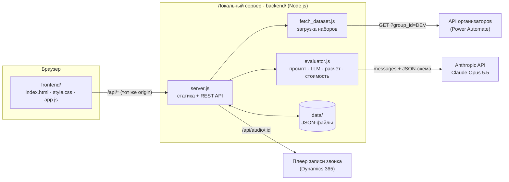
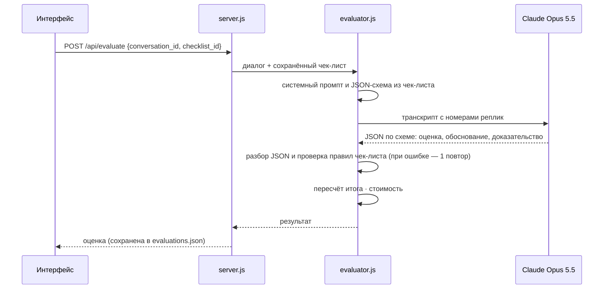

# CQA — Conversation Quality Analytics

Прототип системы контроля качества работы операторов для хакатона **Freedom Broker**.
Система оценивает чаты и звонки на русском, казахском и английском по настраиваемому чек-листу
с помощью LLM, показывает баллы, обоснования и реплики-доказательства, а также поддерживает
апелляцию оценки и решение проверяющего с пересчётом итога.

| | |
|---|---|
| **LLM** | Claude Opus 5.5 (`claude-opus-5-5`, Anthropic API) |
| **Средняя стоимость оценки одного чата** | **≈ $0.06** (4 замера: $0.049–0.073 за диалог) |
| **Время оценки** | ≈ 20 секунд на диалог |
| **Стек** | HTML + CSS + JavaScript без сборки · Node.js 18+ · JSON-файлы для хранения |

---

## Содержание

1. [Возможности](#возможности)
2. [Архитектура](#архитектура)
3. [Запуск локально](#запуск-локально)
4. [Сдача результатов](#сдача-результатов)
5. [Работа с интерфейсом](#работа-с-интерфейсом)
6. [Модель и стоимость оценки](#модель-и-стоимость-оценки)
7. [Как устроена оценка](#как-устроена-оценка)
8. [API локального сервера](#api-локального-сервера)
9. [Структура репозитория](#структура-репозитория)
10. [Настройки](#настройки)
11. [Ограничения](#ограничения)

---

## Возможности

**Контур 1 · Оценка**
- Редактор чек-листа: название, вес, тип ответа (Да/Нет, шкала, грубая ошибка), доступность N/A,
  условие N/A, шкала; добавление и удаление критериев, сохранение версий.
  Изменённый чек-лист сразу применяется к оценке — промпт модели собирается из него.
- Выбор диалога из набора организаторов (65 диалогов DEV: 60 чатов и 5 звонков).
- Кнопка «Оценить оператора»: по каждому критерию — ответ, баллы, вес, обоснование,
  цитата-доказательство, ссылки на реплики, проверенный участок для пропущенного действия, причина N/A.
- Клик по обоснованию подсвечивает реплику в окне чата.
- Звонки (`channel = "voice call"`): над транскриптом — плеер записи (`<audio>` со своими кнопками,
  скоростью 1–2× и ссылкой на плеер организаторов). Шкала — активность речи по транскрипту
  (высота — сколько сказано, цвет — оператор / клиент / бот). Клик по шкале, по времени реплики
  или по обоснованию в карточке результата перематывает запись к нужной реплике (`seekToTime`),
  во время прослушивания текущая реплика отмечается в транскрипте. `audio_url` указывает на
  HTML-страницу плеера организаторов, поэтому сервер достаёт из неё mp3 (`/api/audio/:id`).
  Если `audio_url = null`, плеер показывает только шкалу по транскрипту. У чатов плеер скрыт.
- Итог по правилам чек-листа: перераспределение веса N/A, округление до двух знаков,
  грубая ошибка — отдельным флагом; баллы по секциям.

**Мини-дашборд руководителя** (над выбором диалога, пересчитывается по мере оценки)
- Средний балл операторов по оценённым диалогам — с прогресс-баром, минимумом и максимумом.
- «Выявлено грубых ошибок» — красный счётчик; клик открывает диалог с нарушением.
- Топ-1 критерий, по которому теряется больше всего баллов (потеря = вес критерия после
  перераспределения N/A минус набранные баллы), и следующий за ним.
- Учитываются решения проверяющего по апелляциям — показатели строятся по финальным оценкам.

**Контур 2 · Работа с результатом**
- Переключатель «Режим: Оператор / Проверяющий» (без регистрации и входа).
- Оператор оспаривает критерий и оставляет комментарий.
- Проверяющий видит спорную оценку, комментарий и фрагмент диалога, подтверждает или меняет
  оценку с указанием причины. Итог мгновенно пересчитывается; в карточке видны исходная оценка,
  решение и финальный результат.

**Интерфейс**
- Светлая и тёмная тема: кнопка в шапке. По умолчанию — как в системе; выбор запоминается.
  Все цвета заданы токенами в `style.css`, контраст текста в тёмной теме — не ниже 4.5:1 (WCAG AA).

---

## Архитектура



### Фронтенд
Чистый HTML/CSS/JS без сборки и фреймворков. Всё приложение смонтировано в один корневой элемент
`#cqa-app`, стили ограничены классом `.cqa`, код — в пространстве имён `window.CQA`. Адрес API
задаётся через `window.CQA_CONFIG`, поэтому интерфейс можно перенести в **HTML web resource
Dynamics 365** без изменений кода (см. [Настройки](#настройки)).

Экран разделён на две зоны: слева «Настройка чек-листа», справа «Анализ диалога»
(выбор диалога, транскрипт, результат оценки). Тексты диалогов вставляются только как
`textContent` — без `innerHTML`.

### Локальный сервер и обход CORS
API организаторов не отдаёт CORS-заголовки, поэтому браузер не может обратиться к нему напрямую
(руководство участника, стр. 4: «запрашивайте данные через серверную часть»). Локальный сервер
`backend/server.js`:

- раздаёт фронтенд с того же адреса — запросы `/api/*` идут на тот же origin, CORS не возникает;
- выполняет запросы к API организаторов на стороне Node.js и сохраняет наборы в `backend/data/`;
- разрешает CORS для `/api/*` (`Access-Control-Allow-Origin: *`) — на случай, если `index.html`
  открыт как файл или встроен в Dynamics 365;
- достаёт ссылку на mp3 из страницы плеера записи (`audio_url` возвращает HTML-плеер
  с подписанной ссылкой на ~1 час), чтобы встроенный `<audio>` мог перематывать к реплике;
- вызывает модель оценки — ключ Anthropic API остаётся на сервере и не попадает в браузер;
- хранит чек-листы, оценки и апелляции в JSON-файлах `backend/data/store/`.

Сервер написан на встроенном модуле `node:http`; единственная зависимость — официальный SDK
`@anthropic-ai/sdk`.

---

## Запуск локально

### 1. Требования
- **Node.js 18 или новее** — проверьте: `node -v`
- **Ключ Anthropic API** — https://console.anthropic.com/settings/keys
- **Ссылка на API организаторов** — кнопка «Открыть GET для DEV» на стр. 3 руководства участника

### 2. Установка зависимостей

```bash
git clone https://github.com/MedgatAuken/DataChallengeFreedom.git
cd DataChallengeFreedom/backend
npm install
```

### 3. Настройка `.env`

```bash
cp .env.example .env
```

Откройте `backend/.env` и заполните два значения:

```ini
# Ссылка из кнопки «Открыть GET для DEV» (параметр group_id можно не указывать)
CQA_API_URL=https://...powerplatform.com/.../invoke?api-version=1&sp=...&sv=1.0&sig=...

# Ключ Anthropic API
ANTHROPIC_API_KEY=sk-ant-...
```

Файл `.env` исключён из git: ссылка на API содержит подпись доступа, а ключ — секрет.

### 4. Загрузка набора диалогов

```bash
npm run fetch
```

Скрипт выполнит `GET` с `group_id=DEV`, проверит ответ и сохранит 65 диалогов
в `backend/data/dev_data.json`:

```
→ GET group_id=DEV ...
✓ Получено диалогов: 65 (total_records=65)
   {"channel":{"agent chat":60,"voice call":5},"language":{"RU":35,"KZ":15,"EN":15}}
✓ Сохранено: .../backend/data/dev_data.json
```

### 5. Запуск сервера

```bash
npm start
```

```
CQA сервер запущен: http://localhost:3000
```

### 6. Открытие интерфейса

Откройте **http://localhost:3000** — сервер отдаёт `frontend/index.html`.

Можно открыть и сам файл `frontend/index.html` двойным кликом: в этом случае интерфейс
обращается к API по адресу `http://localhost:3000/api`, поэтому сервер должен быть запущен.

### Проверка без интерфейса

```bash
npm run test:eval                 # оценка p1-ru-001: критерии, итог и стоимость в консоли
node test_eval.js p1-kz-001       # любой другой диалог, например на казахском
npm run test:stability            # проверка стабильности: 9 диалогов (3 RU, 3 KZ, 3 EN), ≈ $0.55
```

`test_runner.js` по очереди оценивает выборку диалогов, отлавливает ошибки модели по кодам
(`INVALID_JSON`, `RULES_VIOLATION`, `REFUSAL`, `MAX_TOKENS`, ошибки API) и на каждом реальном ответе
проверяет расчёт итога: сумма весов после N/A = 100, сумма баллов = итог, N/A без баллов, грубая
ошибка — отдельный флаг, бэкенд и фронтенд дают одинаковый итог, плюс стресс-варианты «все
допустимые N/A» и «всё N/A». Отдельно предупреждает об эмоциональной лексике и «!» в обоснованиях. Параметры: `--per-lang=N`, `--random`, `--ids=p1-ru-001,p1-kz-002`.
Код возврата 1, если есть ошибки; отчёт сохраняется в `backend/data/eval_results/`.

### Контрольный набор

Организаторы сообщат другой `group_id`. Загрузите его одним из способов:

```bash
npm run fetch -- <GROUP_ID>       # → backend/data/<group_id>_data.json
```

или введите `group_id` в поле «Набор» в шапке интерфейса и нажмите «Обновить из API».

---

## Сдача результатов

По приложению «Как сдать результаты» в корне репозитория лежат два файла в формате JSON 1.0:

```
results/
  dev/results.json     все 65 диалогов DEV (60 чатов и 5 звонков)
  prod/results.json    10 контрольных чатов — формируется за час до стоп-кода
```

Файлы создаёт `backend/generate_results.js`: прогоняет каждый диалог набора через модуль оценки,
собирает объект `{schema_version: "1.0", team_name, model: {mode: "external_api", name}, results}`
и сохраняет компактный JSON в UTF-8. Перед записью каждая запись проверяется на соответствие
формату (`validateResultRecord`), а файл — на уникальность и полноту `conversation_id`.
Диалог, который не удалось оценить, записывается со `status: "error"` и причиной в `error` —
не скрывается и не подменяется нулём.

```bash
cd backend
npm run results:dev                                   # → results/dev/results.json (~25 мин, ≈ $4)
```

**PROD — за час до стоп-кода:**

```bash
npm run fetch -- <GROUP_ID>                                          # 1. скачать контрольный набор
node generate_results.js --prod --group=<GROUP_ID>              # 2. → results/prod/results.json (~5 мин)
cd .. && git add results && git commit -m "Add PROD results" && git push   # 3. обязательно push
```

- Между запросами — пауза 1.5 с (`--delay=мс`); при 429, перегрузке API или таймауте — повтор
  через 20 и 60 с, затем запись `status: "error"`.
- Прогресс сохраняется после каждого диалога (`backend/data/eval_results/progress_<dev|prod>.json`).
  Если прогон прервался, повторный запуск продолжит с места остановки, не оплачивая уже оценённые
  диалоги, и дооценит диалоги с ошибкой. `--fresh` — оценить всё заново.
  Сменить `--team` можно без повторной оценки: файл пересобирается из сохранённого прогресса.
- `--dry-run` — проверить набор, стоимость и время без вызовов модели; `--limit=N` — первые N диалогов.
- `--to-ui` — также записать оценки в интерфейс: дашборд и карточки покажут все диалоги набора.
- PROD обязан содержать ровно 10 записей — скрипт предупреждает, если в наборе другое число.

---

## Работа с интерфейсом

| Шаг | Действие |
|---|---|
| 1 | Справа выберите диалог в списке (группы по языкам, фильтры по языку и каналу). |
| 2 | Нажмите **«Оценить оператора»**. Через ~20 с появятся итог, секции и карточки критериев. |
| 3 | Кликните по обоснованию или номеру реплики — реплика подсветится в чате. |
| 4 | В режиме **Оператор** нажмите «Оспорить» у критерия, напишите комментарий, сохраните. |
| 5 | Переключитесь в режим **Проверяющий**, нажмите «Подтвердить оценку» или «Изменить оценку», укажите причину — итог пересчитается. |
| 6 | Слева измените критерий (название, вес, N/A, описание) и снова нажмите «Оценить оператора» — несохранённые правки сохранятся автоматически, модель оценит диалог по новым правилам. Кнопка «Новая версия» сохраняет чек-лист как v2, не затирая v1. |

Сводный список обращений — вкладка **«Апелляции»** в шапке.

---

## Модель и стоимость оценки

Используется **Claude Opus 5.5** (`claude-opus-5-5`) через официальный SDK `@anthropic-ai/sdk`:
adaptive thinking с глубиной `effort: high`, ответ в режиме structured outputs (строгая JSON-схема),
кэширование системного промпта, серверный fallback на случай отказа модели.

**Тариф:** $4 за 1 млн входных токенов, $20 за 1 млн выходных, $0.20 за 1 млн токенов из кэша
(запись в кэш — 1.25 × входного тарифа).

**Замеры на наборе DEV** (одна оценка = один вызов модели):

| Диалог | Вход | Выход* | Кэш (запись / чтение) | Стоимость |
|---|---:|---:|---:|---:|
| p1-ru-001, консоль, первая оценка | 1 015 | 2 339 | 4 412 / 0 | $0.0729 |
| p1-ru-002, интерфейс | 1 605 | 2 185 | 0 / 4 412 | $0.0510 |
| p1-ru-001, интерфейс | 1 015 | 2 280 | 4 401 / 0 | $0.0717 |
| p1-ru-001, консоль, повторно | 1 015 | 2 196 | 0 / 4 401 | $0.0489 |
| **Среднее** | | | | **≈ $0.061** |

\* включая токены размышлений модели — они оплачиваются как выходные.

**Прогон `test_runner.js`** на 9 диалогах (3 RU, включая звонок на 78 реплик, 3 KZ, 3 EN):
9/9 успешно, 0 ошибок разбора JSON, 0 повторных попыток, **$0.536 всего — $0.0595 за диалог**,
от $0.044 (короткий чат EN) до $0.099 (звонок), 17–34 с на диалог.

- **Средняя стоимость оценки одного чата — ≈ $0.06.** Первая оценка после паузы дольше
  5 минут стоит ≈ $0.07: системный промпт с чек-листом (~4.4 тыс. токенов) записывается в кэш.
  Последующие — ≈ $0.05.
- **Весь набор DEV (65 диалогов) — ≈ $3.5–4** при оценке подряд, когда промпт читается из кэша.
- Если модель вернула невалидный JSON или ответ нарушает правила чек-листа, выполняется одна
  повторная попытка — такая оценка стоит примерно вдвое дороже. Количество вызовов учитывается в расчёте.

Стоимость считается автоматически (`estimateCost` в `backend/evaluator.js`) по фактическому
`usage` ответа API и выводится в интерфейсе под итогом и в консоли `test_eval.js`.
Модель и глубину рассуждений можно сменить через `CQA_MODEL` и `CQA_EFFORT`
(тарифы Sonnet 5.5 и Haiku 5.5 уже есть в таблице `PRICING`).

---

## Как устроена оценка



**Промпт** (`buildSystemPrompt`) собирается из текущего чек-листа: секции, критерии, веса,
условия N/A, ступени шкал. Отдельно описаны:
- разница между «Нет» (действие было нужно, но пропущено) и «N/A» (выполнено условие неприменимости);
- реплики бота и системные события — только контекст, оценивается оператор;
- разделение консультации и ведения диалога, определение грубых ошибок;
- **анти-галлюцинация:** действие засчитывается только при явном подтверждении репликой; додумывать
  контекст и намерения запрещено — без подтверждения «Нет» или более низкая ступень шкалы
  (N/A по-прежнему ставится, если условие неприменимости следует из транскрипта);
- **специфика устной речи:** в звонках обрывы фраз, слова-паразиты, разговорные обороты и ошибки
  распознавания не снижают оценку — оценивается суть решения; ведение диалога снижается, только если
  клиенту реально пришлось переспрашивать;
- **стиль:** обоснования и резюме — строгим корпоративным языком, без эмоциональных оценок;
- формат обоснования со ссылками на номера реплик.

**Ответ модели** ограничен JSON-схемой. Массив `criteria` — строго по формату JSON 1.0 (см. ниже);
отдельно модель возвращает `notes` (цитата и проверенный участок для интерфейса) и `summary`.
Ответ проверяется по чек-листу: каждый критерий ровно один раз, `value` нужного типа, `null` только
там, где N/A разрешён, число — одна из ступеней шкалы, `evidence_turns` — существующие номера реплик
с 1. При нарушении модель получает перечень ошибок и исправляет ответ (одна повторная попытка).

**Итог** считается в коде, а не моделью (`computeFinalScore` на сервере, `computeScore` во фронтенде):

1. `true` — полный вес, `false` — 0; число — пропорционально шкале, верхняя ступень даёт полный вес.
2. Критерии с `null` (N/A) исключаются, их вес пропорционально перераспределяется между применимыми,
   максимум остаётся 100.
3. Итог округляется до двух знаков; если применимых критериев с весом нет — `final_score = null`.
4. Грубые ошибки (`critical`) в расчёт не входят: `critical_flag` совпадает с `value` критерия
   `critical` и не обнуляет итог.

Пример из приложения организаторов: `contact = true`, `discovery = null`, `identification = null`,
`consultation = 15`, `empathy = true`, `dialogue = 7`, `closure = true` → применимые веса 65,
баллы 10 + 15 + 15 + 10.5 + 5 = 55.5 → **final_score = 85.38** — наш расчёт даёт то же число.

### Формат результата — JSON 1.0

`evaluateConversation()` никогда не бросает исключение и возвращает `{ result, meta }`, где `result` —
запись строго по приложению «Как сдать результаты», а `meta` — служебные данные (модель, попытки,
стоимость, цитаты, разбивка итога).

```json
{
  "conversation_id": "p1-kz-001",
  "status": "ok",
  "criteria": [
    { "criterion_id": "contact", "value": true,
      "rationale": "Требование выполнено: в первом ответе оператор поздоровался на казахском языке и представился (#10).",
      "evidence_turns": [10] },
    { "criterion_id": "identification", "value": null, "rationale": "Критерий неприменим: …", "evidence_turns": [1, 10] },
    { "criterion_id": "consultation", "value": 20, "rationale": "…", "evidence_turns": [10, 11] }
  ],
  "score": { "final_score": 93.75, "critical_flag": false }
}
```

| criterion_id | Критерий | value | Вес |
|---|---|---|---|
| `contact` | Установление контакта | `true` / `false` | 10 |
| `discovery` | Выявление потребности | `true` / `false` / `null` | 15 |
| `identification` | Идентификация | `true` / `false` / `null` | 20 |
| `consultation` | Корректность и полнота | `0, 5, 10, 15, 20` / `null` | 20 |
| `empathy` | Эмпатия | `true` / `false` | 15 |
| `dialogue` | Ведение, скорость, грамотность | `0, 4, 7, 10` | 15 |
| `closure` | Завершение | `true` / `false` / `null` | 5 |
| `critical` | Грубые ошибки | `true` / `false` | — |

- `evidence_turns` — номера реплик **с 1** по всему транскрипту (клиент, бот, система, оператор);
  в интерфейсе реплики пронумерованы так же.
- Если оценить диалог не удалось:
  `{"conversation_id": "…", "status": "error", "criteria": [], "score": null, "error": "<причина>"}`.
- `buildResultsFile(results)` собирает файл целиком (`schema_version`, `team_name`, `model`, `results`),
  `validateResultRecord()` проверяет запись на соответствие формату. Название команды — `CQA_TEAM_NAME`.
- Коды критериев редактируются в интерфейсе («Код критерия» в карточке): при замене критерия
  укажите код, который дадут организаторы. Данные, сохранённые со старыми кодами `c01…c08`
  и нумерацией реплик с 0, переводятся в новый формат автоматически при чтении.

**Апелляции:** решение проверяющего «Изменить оценку» заменяет ответ модели по критерию,
итог пересчитывается тем же алгоритмом. Исходная оценка сохраняется, в карточке видно
«исходная → после пересмотра». При повторной оценке диалога старые апелляции к нему
больше не применяются.

---

## API локального сервера

| Метод | Путь | Назначение |
|---|---|---|
| GET | `/api/health` | Проверка сервера |
| GET | `/api/dataset?group_id=DEV` | Прямой прокси к API организаторов (без сохранения) |
| POST | `/api/dataset/sync?group_id=DEV` | Скачать набор и сохранить в `data/<group>_data.json` |
| GET | `/api/conversations?group_id=DEV` | Список диалогов (без транскриптов) |
| GET | `/api/conversations/:id?group_id=DEV` | Диалог целиком |
| GET | `/api/audio/:id?group_id=DEV` | Редирект на mp3 записи звонка |
| POST | `/api/evaluate` | `{group_id, conversation_id, checklist_id}` → оценка через LLM |
| GET / PUT / DELETE | `/api/store/{checklists\|evaluations\|appeals}[/:id]` | Хранилище чек-листов, оценок и апелляций |

Ошибки возвращаются как `{"error": "...", "isSuccess": false}` с соответствующим HTTP-статусом.

---

## Структура репозитория

```
frontend/
  index.html                 Разметка: шапка, две зоны, шаблон карточки критерия
  style.css                  Стили (белый / тёмно-серый / зелёный), адаптивная вёрстка
  app.js                     Логика интерфейса, расчёт итога, апелляции, режимы
backend/
  server.js                  HTTP-сервер: статика, REST API, прокси, запуск оценки
  evaluator.js               Промпт, вызов Claude, проверка ответа, расчёт итога, стоимость
  fetch_dataset.js           Загрузка набора из API организаторов (CLI и модуль)
  test_eval.js               Оценка одного диалога из консоли
  test_runner.js             Проверка стабильности: 9 диалогов RU/KZ/EN, ошибки LLM, расчёт итога
  generate_results.js        Файл для сдачи: results/dev|prod/results.json в формате JSON 1.0
  config.js                  Порт, пути, загрузка .env
  .env.example               Шаблон настроек
  package.json
  data/
    checklist_default.json   Чек-лист из PDF организаторов — начальная конфигурация
    dev_data.json            Набор DEV (создаётся `npm run fetch`, в git не входит)
    store/                   Чек-листы, оценки, апелляции (создаётся автоматически)
    eval_results/            Отчёты тестов и прогресс generate_results.js (в git не входит)
results/
  dev/results.json           Результаты по DEV в формате JSON 1.0 — для сдачи
  prod/results.json          Результаты по контрольному набору — для сдачи
```

---

## Настройки

Переменные читаются из окружения или из `backend/.env`.

| Переменная | По умолчанию | Назначение |
|---|---|---|
| `CQA_API_URL` | — | Адрес GET-API организаторов (без `group_id`) — **обязательно** |
| `ANTHROPIC_API_KEY` | — | Ключ Anthropic API — **обязательно для оценки** |
| `CQA_MODEL` | `claude-opus-5-5` | Модель оценки |
| `CQA_EFFORT` | `high` | Глубина рассуждений: `low`, `medium`, `high`, `xhigh`, `max` |
| `CQA_GROUP_ID` | `DEV` | Набор по умолчанию |
| `CQA_TEAM_NAME` | `room-801` | `team_name` в results.json |
| `PORT` | `3000` | Порт сервера |

**Встраивание в Dynamics 365.** Загрузите `index.html`, `style.css` и `app.js` как веб-ресурсы
и задайте адрес развёрнутого сервера до подключения `app.js`:

```html
<script>window.CQA_CONFIG = { apiBase: 'https://<ваш-сервер>/api' };</script>
```

**Сброс к исходному чек-листу.** Удалите `backend/data/store/checklists.json` и обновите
страницу — сервер снова загрузит 8 критериев из `checklist_default.json`.

---

## Ограничения

- Оценка идёт по транскрипту. Дикция и интонация в звонках не оцениваются: для этого нужен
  анализ звука, а модель получает только текст.
- Диалоги оцениваются по одному; пакетной оценки набора одной кнопкой пока нет.
- Хранилище — JSON-файлы на одном сервере, без авторизации и одновременной работы нескольких
  пользователей; роли «Оператор / Проверяющий» — симуляция для демонстрации.
- Перемотка записи к реплике считается от времени первой реплики звонка и может немного
  расходиться с началом файла записи.
- Подписанная ссылка на запись звонка действует около часа; сервер получает новую автоматически.
